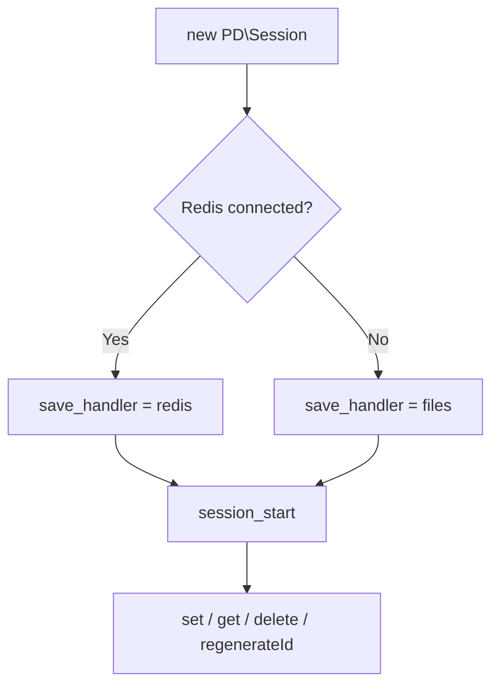

Last updated: 2026-10-25

> [!NOTE]
> This README was generated by [SKILL](https://github.com/agenvoy/skill-readme-generate), get the ZH version from [here](./doc/README.zh.md).

---

<strong>SESSIONS THAT SURVIVE A REDIS OUTAGE!</strong>

---

> A PHP session manager with Redis-backed storage, automatic filesystem fallback, and session fixation protection

## Table of Contents

- [Features](#features)
- [Architecture](#architecture)
- [License](#license)
- [Author](#author)

## Features

> `composer require pardnchiu/session` · [Documentation](./doc/doc.md)

- **Redis First, Files as Fallback** — Native PHP sessions move to Redis while it is available and fall back to storage/sessions under the document root when it is not.
- **Native Session Compatible** — Only the save handler and save path change, so existing code that reads and writes $_SESSION keeps working untouched.
- **Seven-Day Login Retention** — Cookie lifetime and garbage collection lifetime are both set to 7 days, keeping users signed in across browser restarts.
- **Session Fixation Protection** — One method regenerates the session ID and deletes the old session data at the same time.
- **Creation Time Tracking** — The session creation time is recorded on first lookup, making idle or absolute timeouts easy to build.

## Architecture

> [Full Architecture](./doc/architecture.md)

## License

This project is licensed under the [MIT LICENSE](LICENSE).

## Author

Just [open an issue](https://github.com/pardnio/php-session-fallback/issues/new) to share an idea.

---

©️ 2024 [邱敬幃 Pardn Chiu](https://www.linkedin.com/in/pardnchiu)
