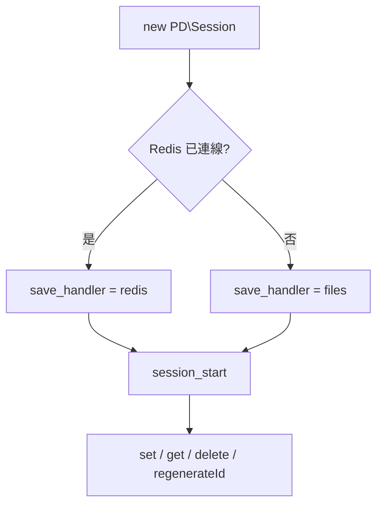

最後更新：2026-10-25

> [!NOTE]
> 此 README 由 [SKILL](https://github.com/agenvoy/skill-readme-generate) 生成，英文版請參閱 [這裡](../README.md)。

---

<strong>SESSIONS THAT SURVIVE A REDIS OUTAGE!</strong>

---

> PHP Session 管理器，具備 Redis 儲存、自動檔案備援與 Session 固定攻擊防護

## 目錄

- [功能特點](#功能特點)
- [架構](#架構)
- [授權](#授權)
- [Author](#author)

## 功能特點

> `composer require pardnchiu/session` · [完整文件](./doc.zh.md)

- **Redis 優先、檔案備援** — Redis 可用時把 PHP 原生 Session 儲存切到 Redis，斷線時自動改存網站根目錄下的 storage/sessions。
- **原生 Session 相容** — 只調整 PHP 的 save handler 與儲存路徑，既有直接操作 $_SESSION 的程式碼不必改寫。
- **七天登入保留** — Cookie 存活期與垃圾回收期一律設為 7 天，使用者關閉瀏覽器後仍維持登入。
- **Session 固定攻擊防護** — 一個方法即可重新產生 Session ID 並同時刪除舊的 Session 資料。
- **建立時間追蹤** — 首次查詢時記錄 Session 建立時間，便於實作閒置或絕對逾時登出。

## 架構

> [完整架構](./architecture.zh.md)

## 授權

本專案採用 [MIT LICENSE](../LICENSE)。

## Author

Just [open an issue](https://github.com/pardnio/php-session-fallback/issues/new) to share an idea.

---

©️ 2024 [邱敬幃 Pardn Chiu](https://www.linkedin.com/in/pardnchiu)
