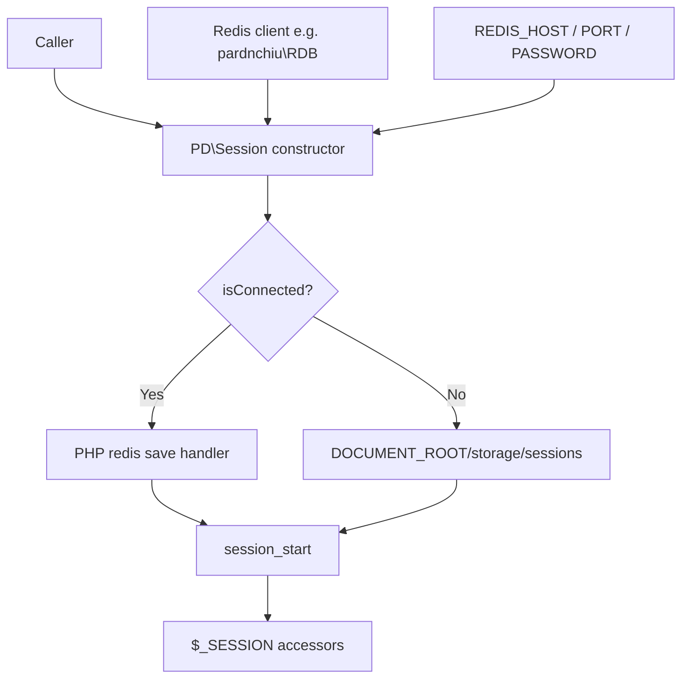
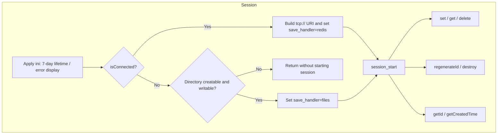
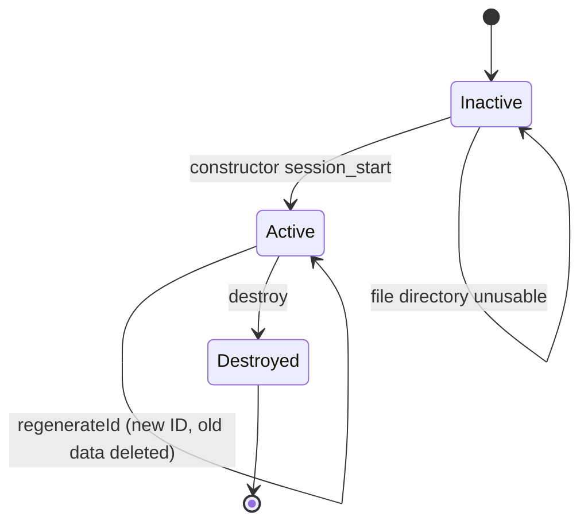

# php-session-fallback - Architecture

Last updated: 2026-10-25

> Back to [README](../README.md)

## Overview

## Module: Session

`PD\Session` picks storage and starts the session during construction; every other method is a thin wrapper over `$_SESSION` and native PHP session functions.

## State Machine

***

©️ 2024 [邱敬幃 Pardn Chiu](https://www.linkedin.com/in/pardnchiu)
