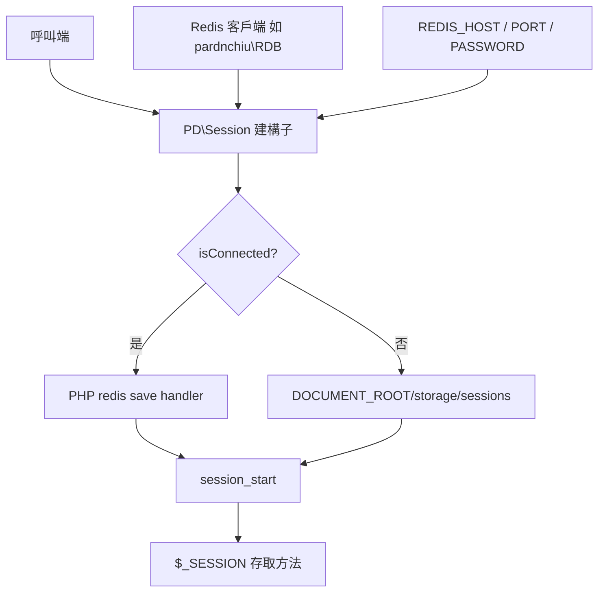
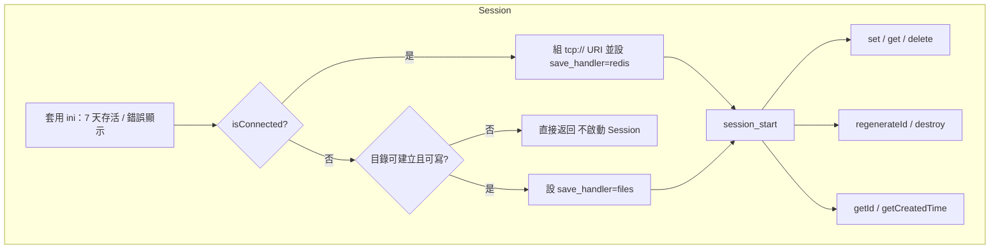
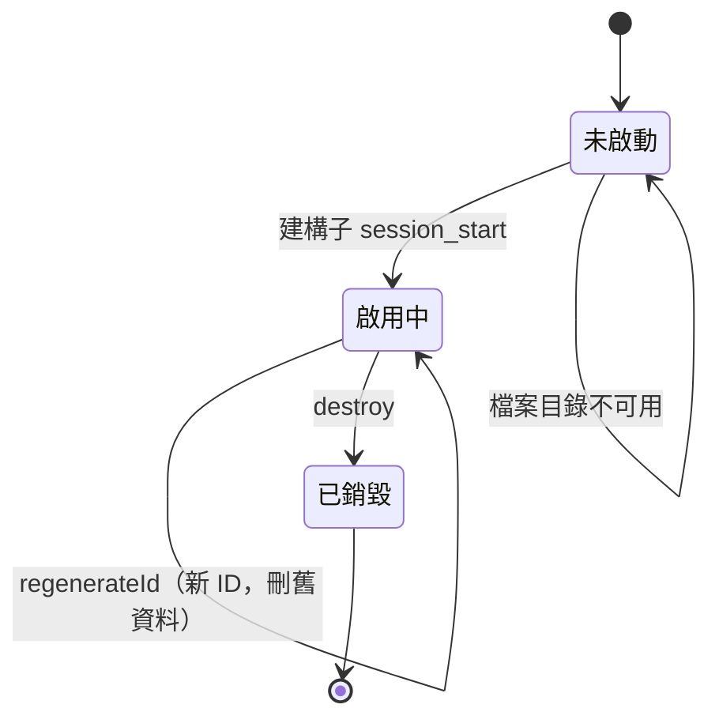

# php-session-fallback - 架構

最後更新：2026-10-25

> 返回 [README](./README.zh.md)

## 概覽

## Module: Session

`PD\Session` 在建構時完成儲存選擇與啟動，其餘方法皆為 `$_SESSION` 與 PHP 原生 session 函式的薄包裝。

## State Machine

***

©️ 2024 [邱敬幃 Pardn Chiu](https://www.linkedin.com/in/pardnchiu)
